  

## Стек

| Область | Инструменты |
|---|---|
| Сети | `Cisco IOS` `Zone-Based Firewall` `ACL` `NAT/PAT` `VLAN` `Wireshark` `tcpdump` `Nmap` `hping3` |
| Linux и инфраструктура | `SSH` `sudo / SUID` `systemd` `Docker Compose` `nginx` `OpenSSL / PKI` `Astra Linux SE` |
| Мониторинг | `Wazuh` `Zabbix` |
| Веб | `Burp Suite` `OWASP Top 10` |
| Языки | `Python` `Bash` `C` `C++` `C#` `SQL` |
| Нормативная база | `Методика ФСТЭК 2021` `152-ФЗ` `187-ФЗ` `Приказы ФСТЭК № 17 и № 21` |

Проекты закреплены ниже на этой странице.
